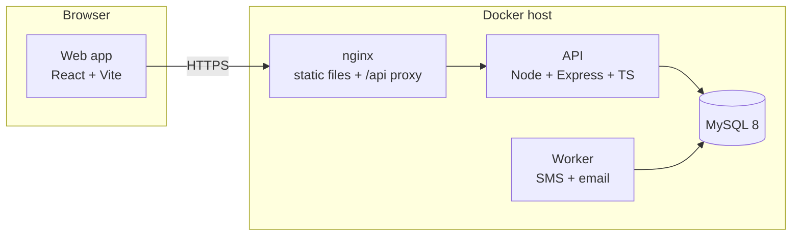
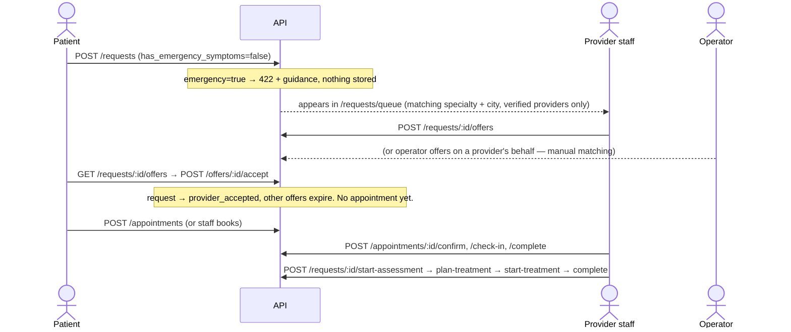

# Architecture

CareBridge is a coordination layer between patients and existing healthcare capacity in Lagos. It does
not run clinics: it routes a patient's request to verified providers, records who agreed to what, and
tracks the journey through assessment, treatment and follow-up.

## Components



| Component | Where | Responsibility |
|---|---|---|
| Web app | `apps/web` | Patient, provider and operations portals. Pure client; holds no business rules it can't get from the API. |
| nginx | `apps/web/nginx.conf` | Serves the built SPA, proxies `/api` and `/health` to the API so the browser sees one origin (no CORS), sets security headers. |
| API | `apps/api` | All business rules, permissions, state transitions, audit logging. Stateless; scale horizontally. |
| MySQL | `docker-compose.yml` | System of record. Schema owned by migrations in `apps/api/src/db/migrations`. |
| Worker | `apps/api/src/worker.ts` | Sends queued SMS/email notifications with retries. Same image as the API; several can run at once. |

Planned: installable web app (PWA), more SMS/email provider adapters, payment gateway webhooks,
encrypted object storage for clinical documents.

## The care journey

The product design's key rule: **a request, an offer, a referral, an appointment and a treatment are
different events.** Each is its own table with its own lifecycle.



Status machines for every entity are defined once in `apps/api/src/lib/stateMachine.ts`; see
[data-model.md](data-model.md#status-machines).

## Notifications

A **transactional outbox**: services call `notify(tx, users, template, payload)` inside the same transaction
as the change, so a notification exists if and only if the change committed. In-app rows are delivered
immediately (the web bell polls `/notifications/unread-count`); SMS/email rows are `queued` and the worker
sends them, retrying after 1, 2, 4, 8 minutes, then marking them `failed` after 5 attempts. Rows for a
switched-off channel, a missing address or a suspended user are `skipped`.

| Event | Who is told | Channels |
|---|---|---|
| New request | owners/clinicians/schedulers of every matching verified clinic | in-app |
| Offer made | the patient | in-app, SMS |
| Offer accepted | owners/clinicians/schedulers of that clinic | in-app, email |
| Offer declined | the staff member who made it | in-app |
| Appointment booked | the other side (clinic staff if the patient booked, else the patient) | in-app + email (clinic) / SMS (patient) |
| Appointment confirmed | the patient | in-app, SMS |
| Appointment cancelled | the other side | in-app + SMS (patient) / email (clinic) |
| Journey step (assessment, plan, treatment, completed) | the patient | in-app |
| Request cancelled | clinics with an open offer, and the assigned clinic | in-app |
| Staff account approved | that staff member | in-app, email |
| Added to a clinic team | that staff member | in-app, email |
| Request directed at a clinic | owners/clinicians/schedulers of that clinic only | in-app, email |

Messages never contain clinical text: payloads hold only IDs, clinic names and times (enforced in code and
tested), and SMS text is deliberately generic. Templates live in `modules/notifications/templates.ts`.
Providers (Termii, SMTP, …) are adapters behind one typed interface: [notifications.md](notifications.md).

## Authorisation model

Two layers, checked on every request:

1. **Platform role** on the user: `patient`, `provider_staff`, `operator`, `admin` (route middleware `allow`).
2. **Provider membership** for anything provider-scoped: the user must be linked to that provider
   (`provider_users`) with a suitable role (`owner`, `clinician`, `scheduler`, `receptionist`), and the provider
   must be verified and active. Operators/admins pass this check.
   Where a pending clinic needs a clear answer rather than a bare 403, services check the membership role first
   and the facility's verification second (`providers.service.ts`), so an owner hears
   `409 PROVIDER_NOT_VERIFIED`.

| Action | Who |
|---|---|
| Make / withdraw an offer | owner, clinician, scheduler of that provider; operator; admin |
| Accept / decline an offer | the patient who made the request |
| Book an appointment | the patient; any staff of the assigned provider; operator; admin |
| Confirm / check in / complete / no-show | staff of the provider; operator; admin |
| Progress the clinical journey | owner or clinician of the assigned provider; operator; admin |
| Add / remove clinic team members | `owner` of that verified clinic; operator; admin |
| Verify providers, approve staff, link members | admin |

The API reloads the user on every request, so suspending an account takes effect immediately.

## Request handling inside the API

```
HTTP → helmet/cors/json/rate-limit → router (/api/v1)
     → authenticate (JWT → reload user) → allow(roles)
     → route: parse(ZodSchema, input)
     → service: permission checks, assertTransition, withTransaction { repo calls…, audit(tx) }
     → { data } | AppError → errorHandler → { error: { code, message, details } }
```

## Time, money, identifiers

- Times: UTC in the database and the API (ISO-8601 with offset); the web shows Africa/Lagos (UTC+01:00, no DST).
- Money: `DECIMAL(14,2)` + `currency CHAR(3)`, default `NGN`.
- IDs: `BIGINT UNSIGNED AUTO_INCREMENT`. Not secret — authorisation never relies on IDs being unguessable.
