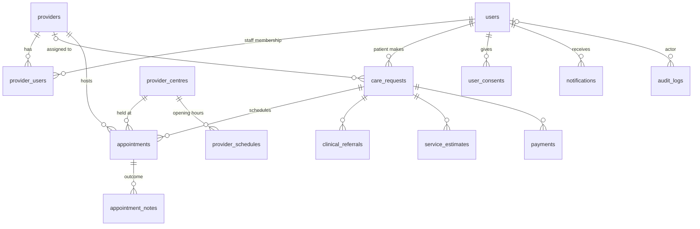
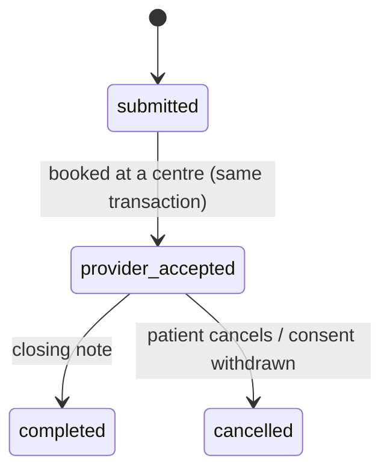
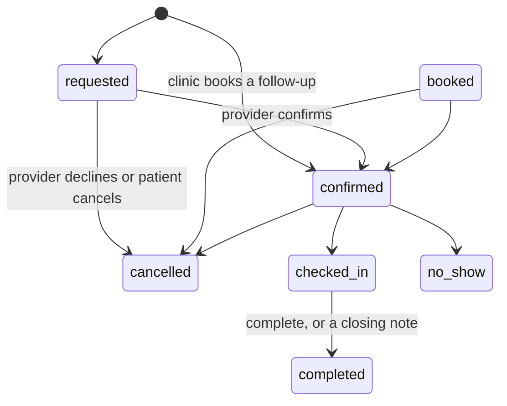

# Data model

MySQL 8, InnoDB, `utf8mb4_0900_ai_ci`. The schema is defined only by the migrations in
`apps/api/src/db/migrations/` (see [migrations.md](migrations.md)); this page describes the result.

## Relationships

## Tables

| Table | Purpose | Key columns / constraints | Used by API? |
|---|---|---|---|
| `users` | Every account | `role` patient/provider_staff/operator/admin · `status` pending/active/suspended · KYC fields: `address_street`, `address_city`, `address_state`, `address_postal`, `date_of_birth`, `gender`, `id_number`, `emergency_contact_name`, `emergency_contact_phone` · `uq_users_email`, `uq_users_phone` | ✅ |
| `providers` | Clinics, hospitals, specialists, diagnostic centres | `verification_status` pending/verified/rejected/suspended · KYC fields: `cac_number`, `tax_id` · `specialties` JSON array · `uq_providers_registration_number` | ✅ |
| `provider_users` | Staff ↔ provider membership | PK (`provider_id`,`user_id`) · `provider_role` owner/clinician/scheduler/receptionist | ✅ |
| `provider_centres` | Operating centres of a provider (clinic locations) | `name`, `address_line`, `city`, `state`, `postal_code`, `phone`, `latitude`, `longitude`, `is_active` · `uq_provider_centres_name` (provider_id, name) | ✅ |
| `care_requests` | A **visit**: one problem, from first booking to closing note | `status` (see below) · `service_type` = the problem's label · `assigned_provider_id` = the clinic booked · `preferred_city` = the centre's area · `description` is **clinical text** (the patient's words) | ✅ |
| `provider_offers` | Retired offer round (kept, unused — [ADR 0005](decisions/0005-mvp-realignment.md)) | `uq_provider_offers_request_provider` | ❌ |
| `appointments` | Scheduled visits | `chk_appointments_time_order` (end > start) · `idx_appointments_centre_time` (centre_id, starts_at, ends_at, status) for free-time checks · `status` includes `requested` · `appointment_mode` physical/remote · `centre_id` · `caregiver_id` → `provider_caregivers` (SET NULL) | ✅ |
| `provider_schedules` | Weekly opening hours per centre, **Lagos wall-clock time** — free times are computed from these | `centre_id` · `uq_provider_schedules_day`, `day_of_week` (0 = Sunday), `open_time`, `close_time`, `slot_duration_minutes` | ✅ |
| `provider_slots` | Retired pre-generated slots (kept, unused: free times are computed) | `centre_id` · `start_time`, `end_time`, `status` | ❌ |
| `provider_caregivers` | Caregivers / clinicians at a centre | `full_name`, `role` dentist/caregiver/hygienist/specialist, `is_active` · `centre_id` | ✅ |
| `provider_fees` | Customizable fee types per provider/centre | `fee_type` consultancy/treatment/late_change/rescheduling/no_show/other · `amount DECIMAL(14,2)`, `currency CHAR(3)` · `is_active` | ✅ |
| `appointment_notes` | Post-visit notes added by provider | `appointment_id`, `author_user_id`, `note_type` follow_up/referral/prescription/closing_consultancy, `summary` | ✅ |
| `clinical_referrals` | Clinician-to-clinician referrals (legacy endpoints; referrals are now notes) | `clinical_summary` is clinical text | legacy |
| `service_estimates` | Estimated charges | `amount DECIMAL(14,2)`, `chk_service_estimates_amount` ≥ 0 | ✅ |
| `clinical_documents` | Photos, X-rays, lab reports in encrypted storage | `care_request_id`, `uploader_user_id`, `storage_key`, `document_type` | ✅ |
| `payments` | Payment records | `uq_payments_provider_reference` | ✅ |
| `user_consents` | Append-only consent history (renamed from `patient_consents`: staff accept terms too) | `consent_type` terms/privacy/data_sharing/marketing · `version` · `granted` · `source` registration/settings/request_form · `ip_address` · `revoked_at` | ✅ |
| `notifications` | Outbound message queue + in-app inbox | `channel`, `template_key`, `payload` (IDs/names/times only — never clinical text), `status` queued/sent/failed/skipped, `attempts`, `next_attempt_at`, `last_error`, `read_at` | ✅ |
| `audit_logs` | Append-only who-did-what | `action`, `entity_type`, `entity_id`, `metadata` JSON (IDs/statuses only — never clinical text) | ✅ every write |
| `schema_migrations` | Migration bookkeeping (managed by the runner) | `version`, `name`, `checksum`, `execution_ms` | runner only |

All tables have `created_at`; mutable ones also have `updated_at` (`ON UPDATE CURRENT_TIMESTAMP`).
Every foreign key and index is explicitly named (`fk_…`, `idx_…`, `uq_…`, `chk_…`).

### How the new flows use these tables

- **Clinic self-registration** writes three rows in one transaction: `users` (`role=provider_staff`,
  `status=pending`), `providers` (`verification_status=pending`, `status=active`) and `provider_users`
  (`provider_role=owner`), plus a `PROVIDER_SELF_REGISTERED` audit row. No new tables or columns.
- **Team management** is `provider_users` only. An `owner` of a verified clinic inserts or deletes rows for
  `clinician`/`scheduler`/`receptionist` (`TEAM_ROLES`); `owner` rows are never removable through that path.
  Adding a `pending` account also flips `users.status` to `active` (audited `USER_ACTIVATED`).
- **Operating centres** (`provider_centres`) belong to a provider; a clinic with several locations has one
  centre each. `city` is the area patients are matched on (Ikeja, Lekki…), `state` the fallback.
- **Free times are computed, not stored.** For a centre: its `provider_schedules` (Lagos time) laid out in
  `slot_duration_minutes` steps, minus `appointments` at that centre in `requested`/`booked`/`confirmed`/
  `checked_in` that overlap, minus anything less than an hour away. One appointment at a time per centre.
  Booking locks the `provider_centres` row (`SELECT … FOR UPDATE`, first statement of the transaction) and
  re-checks the exact time. Code: `modules/availability/`.
- **Search** matches a problem to specialties (`problems.ts`) against `providers.specialties`, keeps verified,
  active clinics and active centres, and ranks centres by area: same `city` as the patient (KYC address or the
  search's override), then same `state`, then elsewhere.
- **Fees:** `provider_fees` with `fee_type = consultancy` is shown in search; a centre row overrides the
  clinic-wide row (`centre_id IS NULL`).
- **Booking** a new visit inserts `care_requests` (`submitted → provider_accepted` through the state machine,
  `assigned_provider_id` = the clinic) and an `appointments` row (`requested`; `confirmed` when clinic staff
  book a follow-up). Follow-ups reuse the visit's `care_request_id`.
- **Notes** (`appointment_notes`) are written after check-in. `prescription` and `referral` by owner/clinician;
  `follow_up` and `closing_consultancy` also by scheduler. A closing note completes the appointment and closes
  the visit when no other appointment on it is pending. Notes are clinical: only the patient and the clinic
  read them.
- **Patient KYC** (`users.*`) holds one changeable address used for area matching, plus DOB, gender, ID number
  and emergency contact. **Provider KYC** (`cac_number`, `tax_id`) is verified manually by an admin.

## Status machines

Defined once in `apps/api/src/lib/stateMachine.ts`. Any other transition returns `409 INVALID_TRANSITION`.

### care_requests.status (visits)

The older states (`matching`, `assessment`, `treatment_planned`, `in_progress`) remain in the column and the
state machine for existing rows; nothing new enters them. The web app shows them all as "Open".

### appointments.status

## Sensitive data

| Column | Sensitivity | Rules |
|---|---|---|
| `care_requests.description`, `appointment_notes.summary`, `clinical_referrals.clinical_summary` | Clinical | Never logged (logger redacts), never in audit metadata, only shown to the patient, related providers and CareBridge staff |
| `users.phone`, `users.email`, `users.full_name` | Personal | Patient contact shown only to the assigned provider and CareBridge staff |
| `users.password_hash` | Secret | bcrypt (cost 12); never selected except at login |
