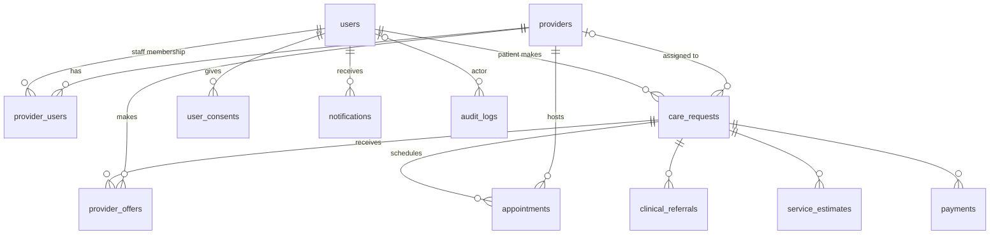
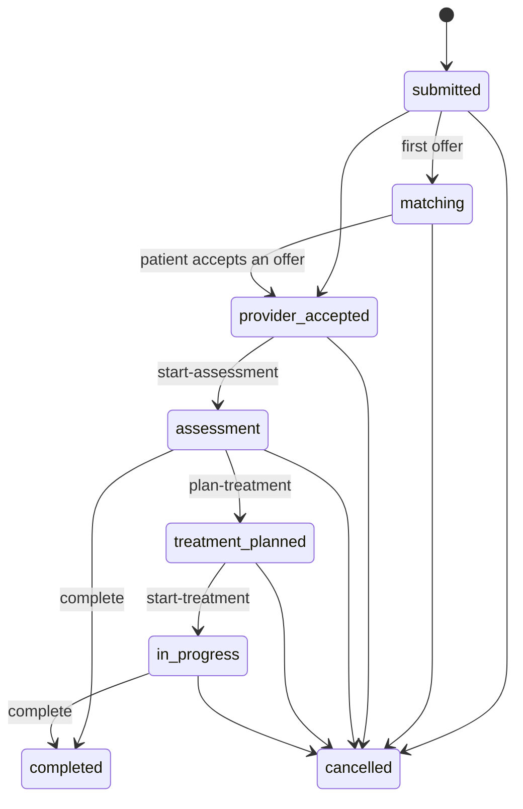
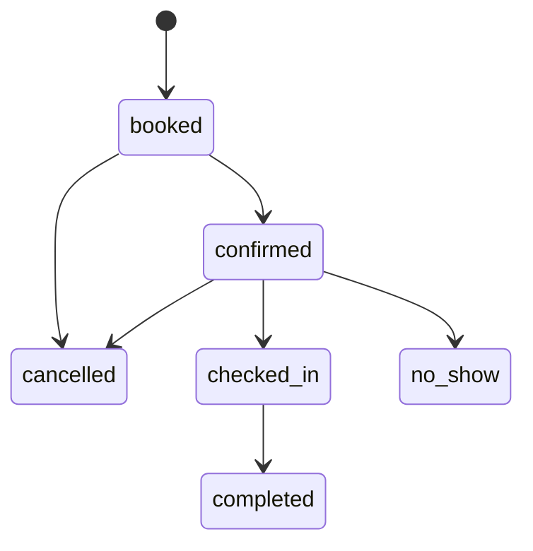

# Data model

MySQL 8, InnoDB, `utf8mb4_0900_ai_ci`. The schema is defined only by the migrations in
`apps/api/src/db/migrations/` (see [migrations.md](migrations.md)); this page describes the result.

## Relationships

## Tables

| Table | Purpose | Key columns / constraints | Used by API? |
|---|---|---|---|
| `users` | Every account | `role` patient/provider_staff/operator/admin · `status` pending/active/suspended · `uq_users_email`, `uq_users_phone` | ✅ |
| `providers` | Clinics, hospitals, specialists, diagnostic centres | `verification_status` pending/verified/rejected/suspended · `specialties` JSON array · `uq_providers_registration_number` | ✅ |
| `provider_users` | Staff ↔ provider membership | PK (`provider_id`,`user_id`) · `provider_role` owner/clinician/scheduler/receptionist | ✅ |
| `care_requests` | A patient's request — start of every journey | `status` (see below) · `urgency` · `assigned_provider_id` (set when an offer is accepted) · `description` is **clinical text** | ✅ |
| `provider_offers` | A provider offering to take a request | `uq_provider_offers_request_provider` (one per provider per request) · `status` | ✅ |
| `appointments` | Scheduled visits | `chk_appointments_time_order` (end > start) · `idx_appointments_provider_time` for overlap checks | ✅ |
| `clinical_referrals` | Clinician-to-clinician referrals | `clinical_summary` is clinical text | ⏳ table only |
| `service_estimates` | Estimated charges | `amount DECIMAL(14,2)`, `chk_service_estimates_amount` ≥ 0 | ⏳ table only |
| `payments` | Payment records | `uq_payments_provider_reference` | ⏳ table only |
| `user_consents` | Append-only consent history (renamed from `patient_consents`: staff accept terms too) | `consent_type` terms/privacy/data_sharing/marketing · `version` · `granted` · `source` registration/settings/request_form · `ip_address` · `revoked_at` | ✅ |
| `notifications` | Outbound message queue + in-app inbox | `channel`, `template_key`, `payload` (IDs/names/times only — never clinical text), `status` queued/sent/failed/skipped, `attempts`, `next_attempt_at`, `last_error`, `read_at` | 🟡 tables ready, sending in progress |
| `audit_logs` | Append-only who-did-what | `action`, `entity_type`, `entity_id`, `metadata` JSON (IDs/statuses only — never clinical text) | ✅ every write |
| `schema_migrations` | Migration bookkeeping (managed by the runner) | `version`, `name`, `checksum`, `execution_ms` | runner only |

All tables have `created_at`; mutable ones also have `updated_at` (`ON UPDATE CURRENT_TIMESTAMP`).
Every foreign key and index is explicitly named (`fk_…`, `idx_…`, `uq_…`, `chk_…`).

## Status machines

Defined once in `apps/api/src/lib/stateMachine.ts`. Any other transition returns `409 INVALID_TRANSITION`.

### care_requests.status

### provider_offers.status

`offered` → `accepted` | `declined` | `expired` | `withdrawn` (all terminal). Accepting one offer expires the others.

### appointments.status

## Sensitive data

| Column | Sensitivity | Rules |
|---|---|---|
| `care_requests.description`, `clinical_referrals.clinical_summary` | Clinical | Never logged (logger redacts), never in audit metadata, only shown to the patient, related providers and CareBridge staff |
| `users.phone`, `users.email`, `users.full_name` | Personal | Patient contact shown only to the assigned provider and CareBridge staff |
| `users.password_hash` | Secret | bcrypt (cost 12); never selected except at login |
