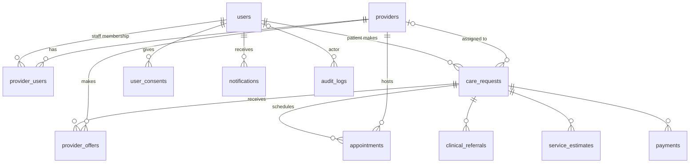
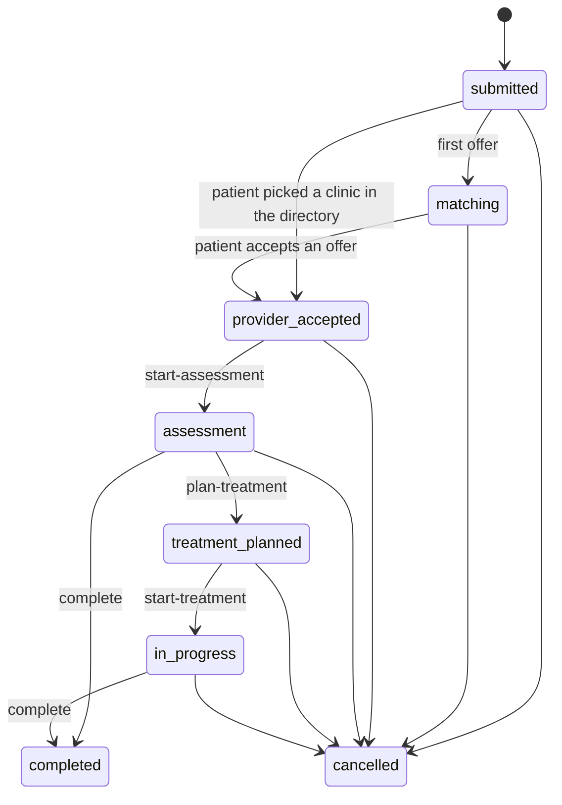
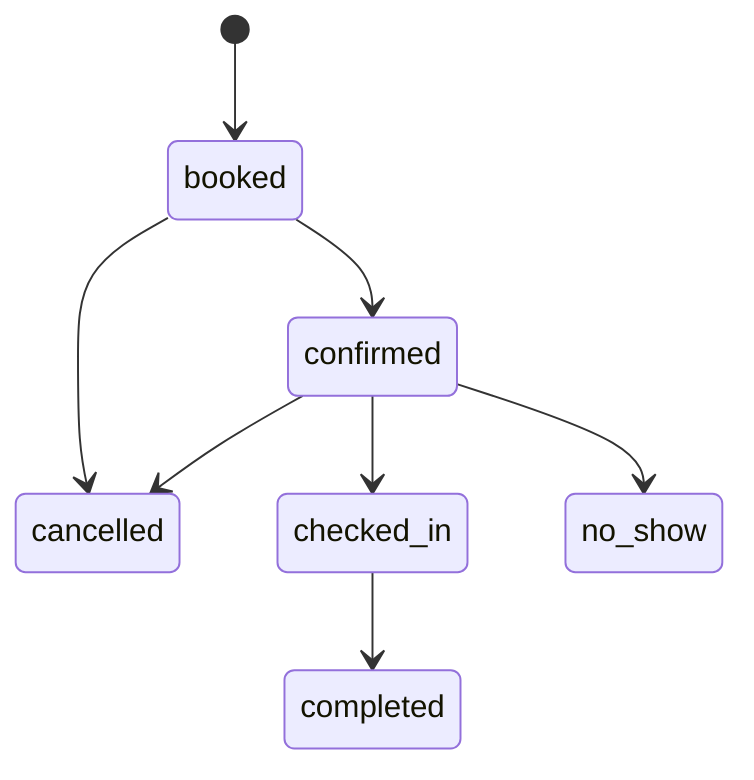

# Data model

MySQL 8, InnoDB, `utf8mb4_0900_ai_ci`. The schema is defined only by the migrations in
`apps/api/src/db/migrations/` (see [migrations.md](migrations.md)); this page describes the result.

## Relationships

## Tables

| Table | Purpose | Key columns / constraints | Used by API? |
|---|---|---|---|
| `users` | Every account | `role` patient/provider_staff/operator/admin · `status` pending/active/suspended · `uq_users_email`, `uq_users_phone` | ✅ |
| `providers` | Clinics, hospitals, specialists, diagnostic centres | `verification_status` pending/verified/rejected/suspended · `specialties` JSON array · `uq_providers_registration_number` | ✅ |
| `provider_users` | Staff ↔ provider membership | PK (`provider_id`,`user_id`) · `provider_role` owner/clinician/scheduler/receptionist | ✅ |
| `care_requests` | A patient's request — start of every journey | `status` (see below) · `urgency` · `assigned_provider_id` (set when an offer is accepted, or when a patient directs the request at a clinic) · `description` is **clinical text** | ✅ |
| `provider_offers` | A provider offering to take a request | `uq_provider_offers_request_provider` (one per provider per request) · `status` | ✅ |
| `appointments` | Scheduled visits | `centre_id`, `caregiver_user_id`, `appointment_mode` (physical/video_call/voice_call); `chk_appointments_time_order` (end > start) · `idx_appointments_provider_time` for overlap checks | ✅ |
| `provider_centres` | Operating centres (branches) of a provider | `name`, `address`, `city`, `phone`, `is_active`; `uq_provider_centres_name` | ✅ |
| `provider_schedules` | Weekly opening hours per centre | `centre_id`, `day_of_week` (0-6), `open_time`, `close_time`, `slot_duration_minutes`; `uq_provider_schedules_centre_day` | ✅ |
| `provider_slots` | Bookable appointment slots per centre | `centre_id`, `start_time`, `end_time`, `status` available/held/booked/cancelled; `uq_provider_slots_centre_time` | ✅ |
| `provider_caregivers` | Caregivers (clinicians) linked to a centre | `centre_id`, `user_id`, `is_active`; `uq_provider_caregivers_centre_user` | ✅ |
| `clinical_referrals` | Clinician-to-clinician referrals | `clinical_summary` is clinical text | ✅ |
| `service_estimates` | Estimated charges | `amount DECIMAL(14,2)`, `chk_service_estimates_amount` ≥ 0 | ✅ |
| `clinical_documents` | Photos, X-rays, lab reports in encrypted storage | `care_request_id`, `uploader_user_id`, `storage_key`, `document_type` | ✅ |
| `appointment_notes` | Consultation notes added after a visit | `appointment_id`, `note_type`, `notes`, `created_by_user_id`; append-only | ✅ |
| `payments` | Payment records | `uq_payments_provider_reference` | ✅ |
| `user_consents` | Append-only consent history (renamed from `patient_consents`: staff accept terms too) | `consent_type` terms/privacy/data_sharing/marketing · `version` · `granted` · `source` registration/settings/request_form · `ip_address` · `revoked_at` | ✅ |
| `notifications` | Outbound message queue + in-app inbox | `channel`, `template_key`, `payload` (IDs/names/times only — never clinical text), `status` queued/sent/failed/skipped, `attempts`, `next_attempt_at`, `last_error`, `read_at` | ✅ |
| `audit_logs` | Append-only who-did-what | `action`, `entity_type`, `entity_id`, `metadata` JSON (IDs/statuses only — never clinical text) | ✅ every write |
| `schema_migrations` | Migration bookkeeping (managed by the runner) | `version`, `name`, `checksum`, `execution_ms` | runner only |

All tables have `created_at`; mutable ones also have `updated_at` (`ON UPDATE CURRENT_TIMESTAMP`).
Every foreign key and index is explicitly named (`fk_…`, `idx_…`, `uq_…`, `chk_…`).

### How the new flows use these tables

- **Clinic self-registration** writes three rows in one transaction: `users` (`role=provider_staff`,
  `status=pending`), `providers` (`verification_status=pending`, `status=active`) and `provider_users`
  (`provider_role=owner`), plus a `PROVIDER_SELF_REGISTERED` audit row. No new tables or columns.
- **Team management** is `provider_users` only. An `owner` of a verified clinic inserts or deletes rows for
  `clinician`/`scheduler`/`receptionist` (`TEAM_ROLES`); `owner` rows are never removable through that path.
  Adding a `pending` account also flips `users.status` to `active` (audited `USER_ACTIVATED`).
- **Directed requests** reuse `care_requests.assigned_provider_id`: the row is inserted as `submitted` and moved
  to `provider_accepted` by the state machine, audited as `CARE_REQUEST_ASSIGNED` with `{ directed: true }`.
- **Post-visit governance** is derived, never stored: `GET /requests/assigned` counts `appointments` for the
  request with `status IN ('checked_in','completed')` as `assessments_completed`. Estimates, referrals and
  treatment planning are refused (`409 VISIT_REQUIRED`) while that count is 0.
- **Operating centres** let a provider run several locations (`provider_centres`), each with its own opening
  hours (`provider_schedules`, scoped to `centre_id`) and bookable slots (`provider_slots`, scoped to
  `centre_id`). Every appointment records the `centre_id` it happens at and an `appointment_mode`
  (`physical`, `video_call`, `voice_call`), plus an optional `caregiver_user_id` linking to an active
  caregiver of that centre (`provider_caregivers`).
- **Consultation notes** (`appointment_notes`) are append-only notes a provider adds to an appointment once
  the patient has been checked in or completed: follow-up plan, referral for further diagnosis, prescriptions,
  or closing the consultation. The note text is audited by ID only and never placed in a notification payload.

## Status machines

Defined once in `apps/api/src/lib/stateMachine.ts`. Any other transition returns `409 INVALID_TRANSITION`.

### care_requests.status

### provider_offers.status

`offered` → `accepted` | `declined` | `expired` | `withdrawn` (all terminal). Accepting one offer expires the others.

### appointments.status

## Sensitive data

| Column | Sensitivity | Rules |
|---|---|---|
| `care_requests.description`, `clinical_referrals.clinical_summary` | Clinical | Never logged (logger redacts), never in audit metadata, only shown to the patient, related providers and CareBridge staff |
| `users.phone`, `users.email`, `users.full_name` | Personal | Patient contact shown only to the assigned provider and CareBridge staff |
| `users.password_hash` | Secret | bcrypt (cost 12); never selected except at login |
